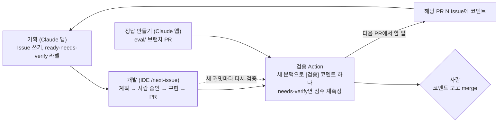

# 원투원

**원투원**은 맞벌이 부부의 연말정산 자료로 공제를 누구에게 넣을지 계산하고, 근거 조문과 함께 설명하는 LLM 에이전트 서비스입니다. 레포와 코드 이름은 `taxsplit`입니다.
세액 계산은 코드가, 대화와 설명은 LLM이, 근거는 검색(RAG)이 맡습니다.

## 구조


| 폴더 | 언어 | 역할 |
| --- | --- | --- |
| `agent/` | Python (FastAPI) | 세액 계산 엔진, 도구 호출 에이전트, 평가 실행 |
| `gateway/` | Kotlin (Spring) | LLM 게이트웨이. 중계·스트리밍, 비용 기록 (레이트 리밋, 장애 대응은 PR 17) |
| `eval/` | - | 채점 규칙, 채점 코드, 정답 데이터. 개발 PR에서는 고칠 수 없음 |

## 개발 흐름

기획 → 개발 → 검증 → merge 순서로 PR 하나가 지나갑니다. 기획은 Claude 앱, 개발은 IDE(Claude Code `/next-issue`), 검증은 GitHub Action, merge는 사람이 합니다. 세션 사이에 내용을 옮기지 않고, 맥락은 Issue·PR 코멘트·문서에 둡니다. 역할 규칙은 [CLAUDE.md](CLAUDE.md) "역할"과 [ADR-0008](docs/adr/0008-verify-by-action.md)이 기준입니다.



## 목표

1. **정확도**: LLM이 계산하지 않는다. 세액 계산 엔진을 국세청 공식 계산 사례로 검증하고, 검증된 엔진으로 기준 정답을 만들어 에이전트를 채점한다.
2. **신뢰성**: 도구 호출 인자를 검사하고, 실패하면 이유를 모델에 돌려줘 재시도하며, 최대 스텝을 넘으면 멈춘다. 평가 하네스로 전후를 숫자로 비교한다.
3. **운영**: Kotlin 게이트웨이에서 레이트 리밋, 재시도·타임아웃·서킷 브레이커·폴백, 호출별 토큰·비용 기록을 처리한다. 장애를 일부러 내서 평가 하네스로 성공률을 잰다.

## 주요 결정

| 번호 | 결정 | 한 줄 요약 |
| --- | --- | --- |
| [0001](docs/adr/0001-sdk-direct-no-langchain.md) | LangChain 없이 SDK 직접 호출 | 호출 흐름을 직접 보고 고칠 수 있게 |
| [0002](docs/adr/0002-python-agent-kotlin-gateway.md) | 에이전트 Python, 게이트웨이 Kotlin | AI 호출 관문을 별도 서비스로 |
| [0003](docs/adr/0003-llm-does-not-calculate.md) | LLM은 계산하지 않는다 | 숫자는 계산 엔진만 낸다 |
| [0004](docs/adr/0004-ground-truth-chain.md) | 정답은 외부에서 온다 | 국세청 사례 → 계산기 → 기준 정답 |
| [0005](docs/adr/0005-guardrails-by-machine.md) | 벽은 기계로 지킨다 | 채점 코드·정답은 CI가 보호 |
| [0006](docs/adr/0006-model-roles.md) | Claude 기본, GPT는 채점만 | 답을 만드는 쪽은 Claude, 채점하는 쪽만 다른 회사 |
| [0007](docs/adr/0007-frontend-react.md) | 화면은 React | v1 화면 기능 4개로 제한 |
| [0008](docs/adr/0008-verify-by-action.md) | 검증은 GitHub Action | 모든 PR에 [검증] 코멘트 하나, 맥락은 레포에 |

전체 목록과 작성 규칙: [docs/adr/README.md](docs/adr/README.md)

## 문서

- 제품 요구사항: [docs/prd.md](docs/prd.md)
- 설계: [docs/design.md](docs/design.md)
- 평가 계획: [docs/eval-plan.md](docs/eval-plan.md)
- 개발 기록: [docs/devlog.md](docs/devlog.md)

## 실행

```bash
cp .env.example .env        # 다른 pc에선 .env에 POSTGRES_PASSWORD 채우기
docker compose up --build
```

- API 문서: http://localhost:8080/docs
- 헬스체크: http://localhost:8080/health

LLM 게이트웨이 (AI 호출을 게이트웨이로 거치게 할 때, 자세한 것은 [gateway/README.md](gateway/README.md)):

```bash
docker compose up -d --build gateway      # 127.0.0.1:8081, .env의 ANTHROPIC_API_KEY 사용
curl 127.0.0.1:8081/usage                 # 호출 수·토큰·비용 합계
# 에이전트 쪽: .env에 LLM_BASE_URL=http://127.0.0.1:8081
```

로컬 개발 (DB · Redis만 컨테이너로):

```bash
docker compose up -d postgres redis
cd agent
uv sync
uv run uvicorn taxsplit.main:app --reload --port 8080
```

테스트 · 린트 (`agent/`에서):

```bash
uv run pytest
uv run ruff check .
uv run ruff format --check .
```

## 기술 선택 이유

- **uv**: 가상환경 · 의존성 · lock · Python 버전 관리를 한 도구로 처리해 재현 가능한 설치를 보장
- **ruff**: 린트와 포맷을 한 도구로, 설정은 pyproject.toml 한 곳에
- **Docker 레이어 분리**: 의존성 레이어를 먼저 두어 코드만 바뀌면 의존성 설치를 캐시로 건너뜀
- **docker compose + healthcheck**: DB가 접속 가능해진 뒤 API가 뜨도록 순서 보장, 로컬 인프라를 명령 하나로 재현
- **pgvector 이미지**: 별도 벡터 DB 없이 Postgres로 RAG까지 처리 (자세한 비교는 ADR 예정)
- **한 레포 두 폴더(agent/, gateway/)**: 빌드 도구를 분리하면서도 PR 하나로 양쪽을 고치고, compose 한 번으로 데모 전체를 띄움
- **LangChain 미사용**: 에이전트 루프, 도구 호출 검사, 평가를 SDK로 직접 구현해 설계를 직접 설명할 수 있게 함
